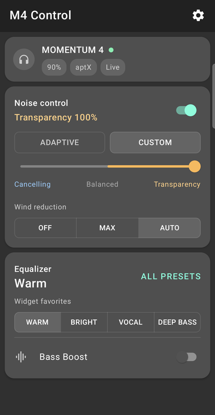
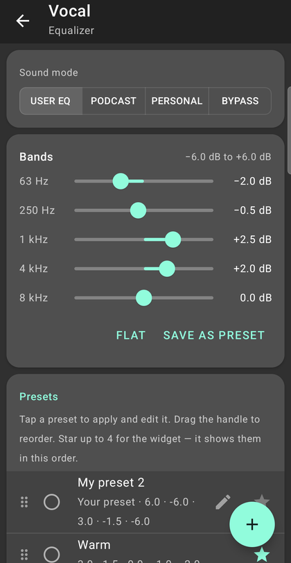
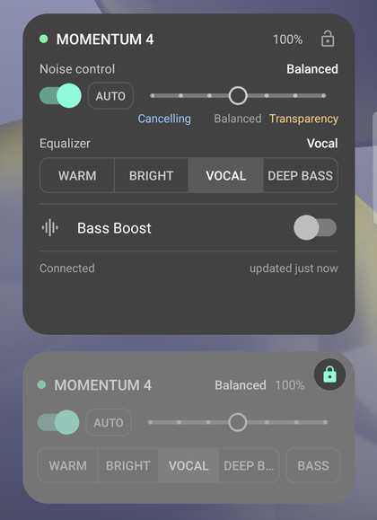
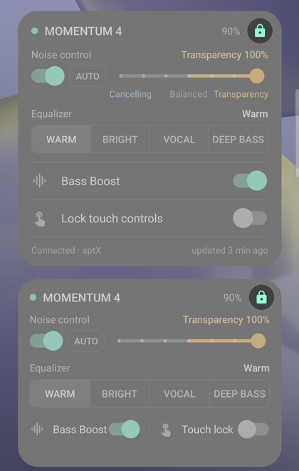

# M4 Control

An Android app and home-screen widget for the **Sennheiser MOMENTUM 4** headphones: noise control,
EQ presets and Bass Boost, one tap away, without opening Smart Control Plus.

<table>
  <tr>
    <td align="center"></td>
    <td align="center"></td>
  </tr>
  <tr>
    <td align="center">Main screen</td>
    <td align="center">Equalizer</td>
  </tr>
  <tr>
    <td align="center"></td>
    <td align="center"></td>
  </tr>
  <tr>
    <td align="center">Widgets — 4-row and 3-row layouts</td>
    <td align="center">Widgets locked — only the lock stays active</td>
  </tr>
</table>

## Features

- **Noise control:** Off, Adaptive, or a Custom mix from full noise cancelling to full transparency;
  wind reduction (Off / Max / Auto).
- **Equalizer:** 5-band editor (−6 to +6 dB), sound modes (User EQ, Podcast, Personalized, Bypass), and
  a preset library — 7 built-in presets plus your own, which you can save, rename, delete (with undo)
  and reorder. The header always names the EQ you're editing, e.g. "Warm · edited".
- **Bass Boost**, battery level and the active codec.
- **Home-screen widget**, one resizable widget with layouts for 1 to 4+ rows: noise switch, Adaptive,
  a 7-stop slider, your 4 favorite presets and Bass Boost; from 3 rows it adds captions and the
  headphones' touch lock. A tap takes about half a second.
- **Widget lock:** a lock in the widget's corner blocks every tap — controls and opening the
  app — until you unlock it. Each widget locks separately; Settings can hide the lock.
- Material Design 1 look with rounded corners, light and dark themes (follow the system or pick one in Settings).
- Optional headphone settings: Smart Pause, on-head detection, touch lock, sidetone.

## Requirements

- Android 8 or newer, with the headphones already paired in Android's Bluetooth settings.
- MOMENTUM 4 on firmware **3.38.3** (the version this was built and tested against; other versions show
  an "untested firmware" notice but are allowed).
- The app is sideloaded — it isn't on Google Play.

Tested on a Samsung Galaxy S24 (Android 16) and a Sony Xperia X Compact (Android 8.0).

## Build and install

```bash
./gradlew :app:assembleDebug
```

```bash
adb install -r app/build/outputs/apk/debug/app-debug.apk
```

For a release build (optimized, about 2 MB), create your own signing key and put its details in a
`keystore.properties` file in the project root (git-ignored):

```properties
storeFile=C:/path/to/your-release.jks
storePassword=...
keyAlias=...
keyPassword=...
```

```bash
./gradlew :app:assembleRelease
```

Without `keystore.properties` the release APK is built unsigned. Debug builds use the app ID
`cz.metlicka.m4control.debug`, so they install next to a release build.

Run the unit tests (frame encoding and stream parsing, request/response handling, noise and EQ
rules):

```bash
./gradlew :app:testDebugUnitTest
```

On first launch, allow **Nearby devices** and pick your headphones. Add the widget from the launcher's
widget picker, or from the app: **Settings → Add widget to home screen**.

## How it works

The app talks to the headphones over Bluetooth Classic (RFCOMM) using Qualcomm's GAIA v3 protocol with
Sennheiser's vendor commands. [`plan.md`](plan.md) has the protocol notes (frame format and the commands
used), the design decisions and what was learned testing on a real device.

```
app/src/main/java/cz/metlicka/m4control/
  gaia/     frame encoding, stream parser, request/response session (plain Kotlin, unit-tested)
  device/   connection owner + command queue, noise and EQ models, Bluetooth access
  state/    app state and persistence
  ui/       Compose screens
  widget/   home-screen widget
  service/  foreground service for widget taps, Bluetooth connection receiver
tools/gen_widget.py   generates the widget layouts and drawables — edit this, not the XML
```

Design mockups: [`app-mockup.html`](app-mockup.html) and [`widget-mockup.html`](widget-mockup.html)
(open in a browser).

## Credits

Protocol details were first worked out by
[f3Y0/momentum4-control](https://github.com/f3Y0/momentum4-control) and
[zaval/sennheiser-desktop-client](https://github.com/zaval/sennheiser-desktop-client).

This is an unofficial project, not affiliated with or endorsed by Sennheiser. "MOMENTUM" and
"Sennheiser" are trademarks of their respective owners.

## License

[MIT](LICENSE) © 2026 Jachym Metlicka
